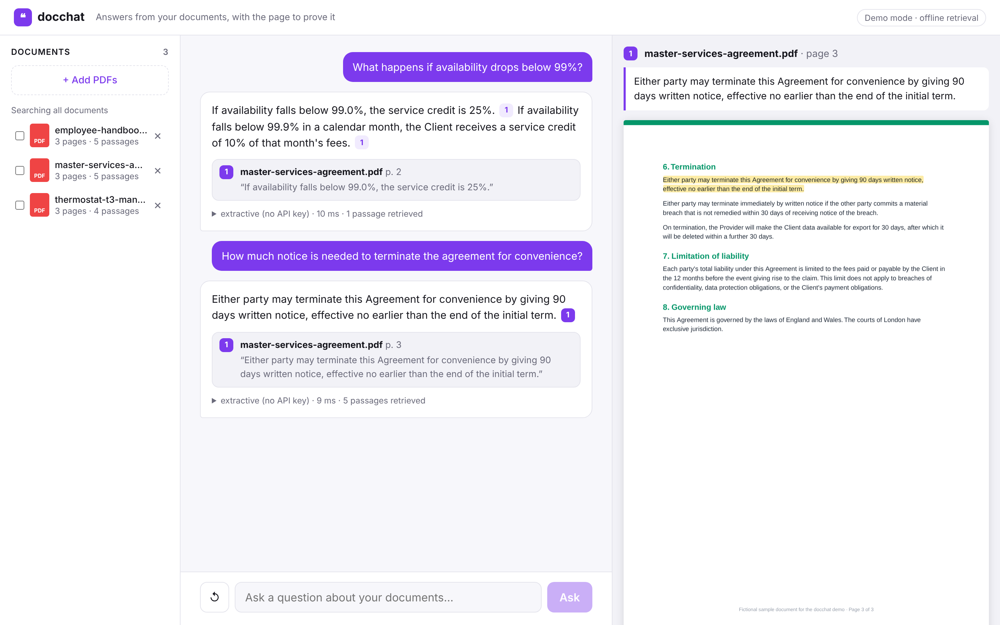
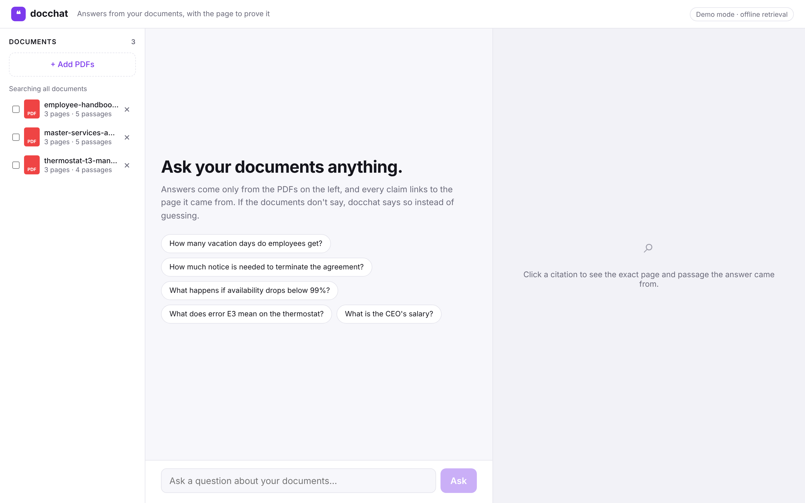
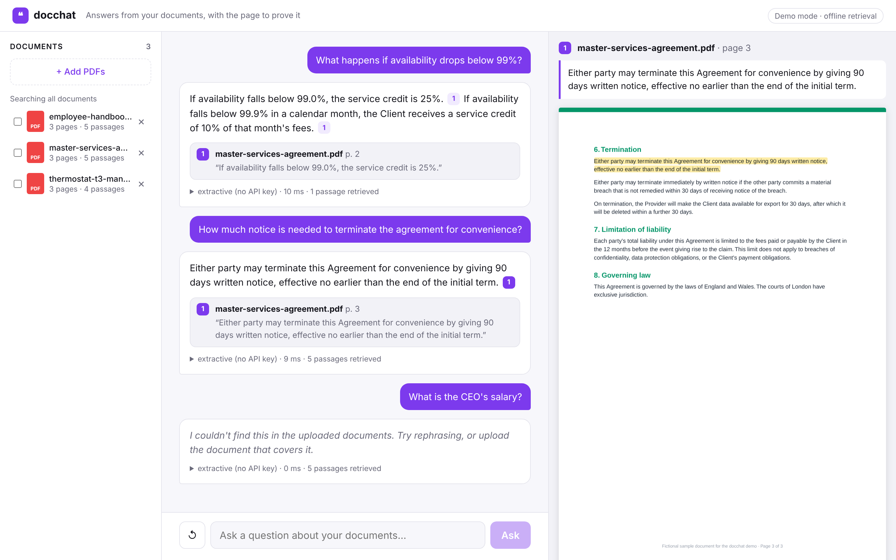
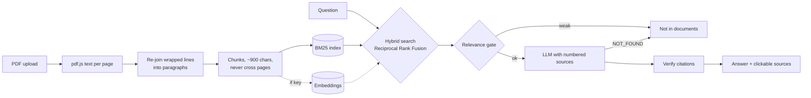

# docchat

**Chat with your PDFs and get answers that cite the exact page, or an honest "not in the documents".**



Most "chat with your docs" demos have two problems that block real use: you can't check where an answer came from, and when the documents don't cover a question the model makes something up. docchat is built around fixing both:

- **Every claim is cited.** Answers carry `[1]`-style citations; clicking one opens the source page with the passage highlighted.
- **It refuses instead of guessing.** A retrieval gate checks whether the documents cover the question at all *before* the model is called, and the model is instructed to answer `NOT_FOUND` otherwise.
- **Citations are verified.** If a model cites a source that wasn't retrieved (`[7]` when there were 5), the citation is dropped instead of shown.

| Start | Out-of-scope question |
|---|---|
|  |  |

## Run it

No API key needed: without one, docchat runs fully offline with BM25 retrieval and an extractive answerer that only quotes the documents. Three fictional sample documents (an employee handbook, a services contract and a product manual) load on start.

```bash
npm install
npm run build
npm start          # http://localhost:3000
```

With an LLM (see `.env.example`):

```bash
ANTHROPIC_API_KEY=... npm start                     # answers by Claude, BM25 retrieval
OPENAI_API_KEY=... npm start                        # answers by GPT + hybrid (BM25 + embeddings) retrieval
ANTHROPIC_API_KEY=... OPENAI_API_KEY=... npm start  # Claude answers, OpenAI embeddings
```

```bash
npm run dev        # API on :3000, UI with hot reload on :5173
npm test           # 24 tests: chunking, ranking, citations, refusals, API
docker build -t docchat . && docker run -p 3000:3000 docchat
```

## How it works



```
server/   Fastify + TypeScript
  src/rag/chunk.ts         page-bounded, sentence-aware chunking with overlap
  src/rag/bm25.ts          Okapi BM25 + IDF-weighted query coverage
  src/rag/knowledge-base.ts  hybrid search (BM25 + embeddings) fused with RRF
  src/rag/ask.ts           relevance gate, generation, citation verification
  src/providers/           Claude / GPT / Gemini answerers, OpenAI / Gemini embeddings, offline answerer
  test/                    Vitest: 9 golden Q&A pairs with expected page, refusal cases, API flow
web/      React + Vite: documents, chat, pdf.js page viewer with passage highlighting
samples/  Fictional documents generated by server/scripts/generate-samples.ts
```

### Design decisions

- **Hybrid retrieval.** Embeddings are great at paraphrase ("drops" vs "falls") and bad at exact identifiers (error code `E3`, clause numbers, `99.9%`). BM25 is the opposite. Ranks are fused with Reciprocal Rank Fusion so neither score scale has to be calibrated against the other.
- **Chunks never cross pages**, so every citation points at exactly one page. Lines that the PDF layout wrapped are re-joined first, otherwise sentences get cut in half.
- **Refusal is a feature.** "What is the CEO's salary?" retrieves a passage mentioning *salary*, but IDF-weighted coverage shows the important term (*CEO*) is missing, so the gate refuses before any model call: cheaper, and no hallucination.
- **Golden-set tests.** The test suite asks 9 real questions and checks the answer text *and* the cited page, plus refusal cases. Changing chunking or ranking without breaking answers is measurable.
- **Follow-ups.** Short follow-up questions ("and for contractors?") borrow the previous question for retrieval; the last turns are passed to the model.

### What I'd add for production

- **pgvector** instead of in-memory indexes, with per-tenant isolation and document permissions applied at query time.
- **Ingestion queue** (BullMQ) for large uploads, plus OCR for scanned PDFs and DOCX/HTML loaders.
- **Re-ranking** with a cross-encoder on the top 20 candidates.
- **Evaluation pipeline**: a larger labelled question set per customer, tracking answer accuracy, citation precision and refusal rate on every change.
- **Streaming answers** and caching of embeddings by content hash.

## License

MIT. Sample documents are fictional and generated by the script in this repository.
